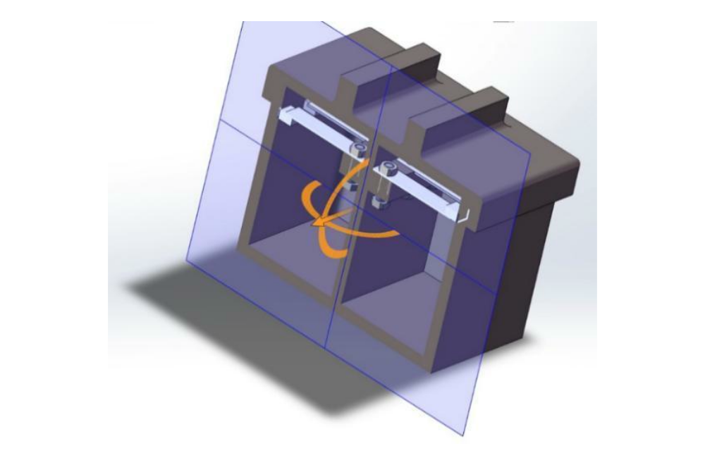
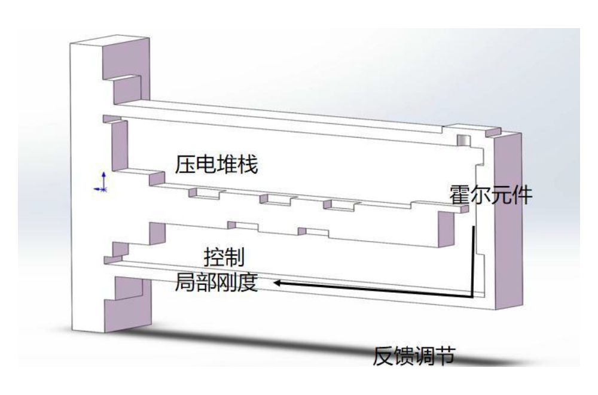
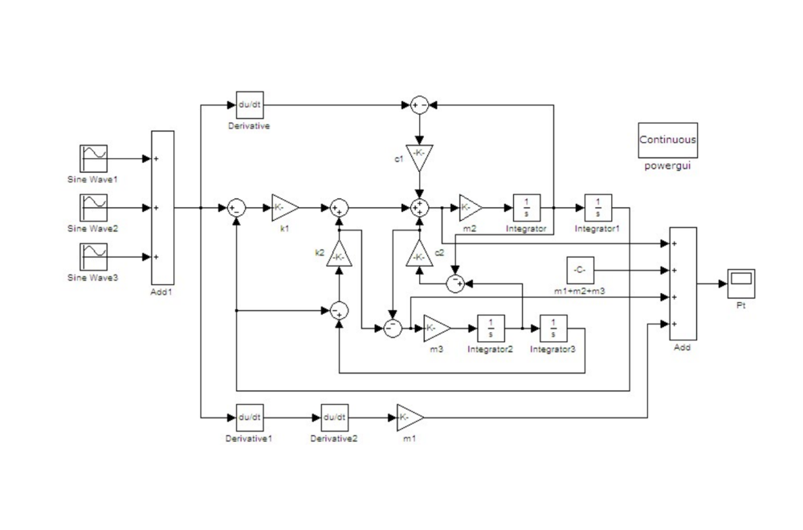
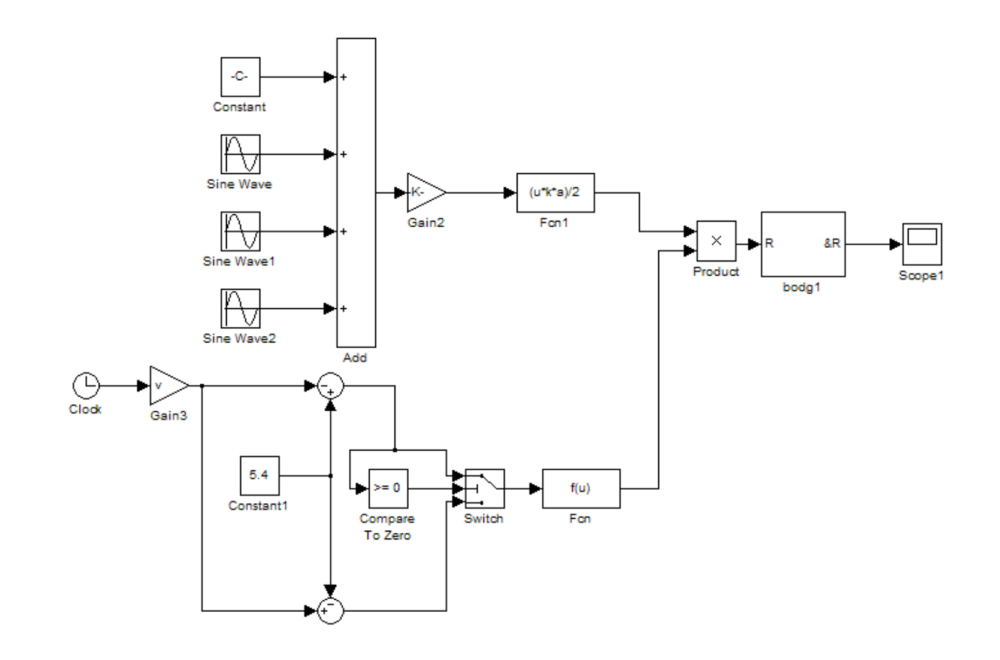
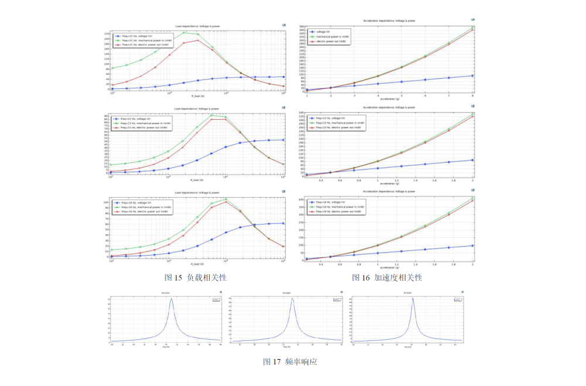
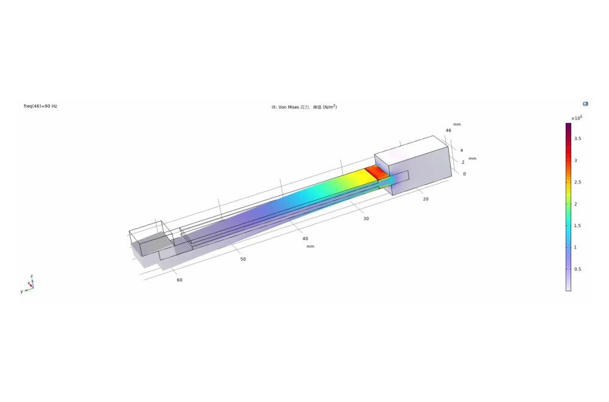
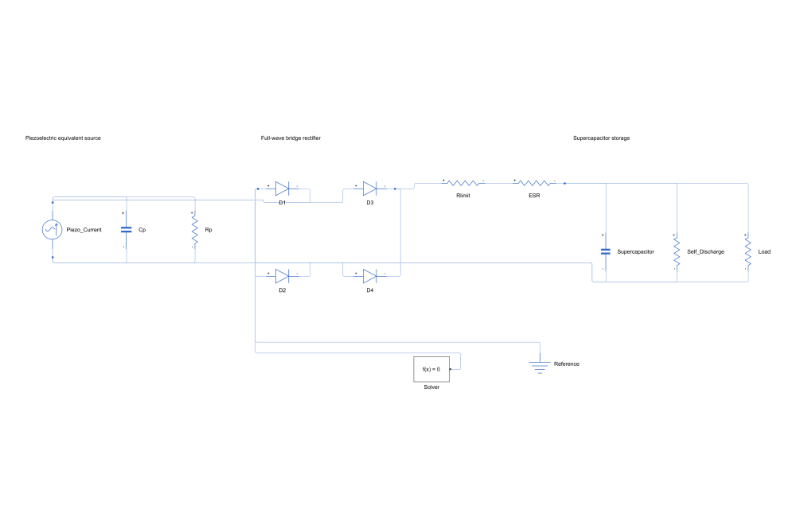
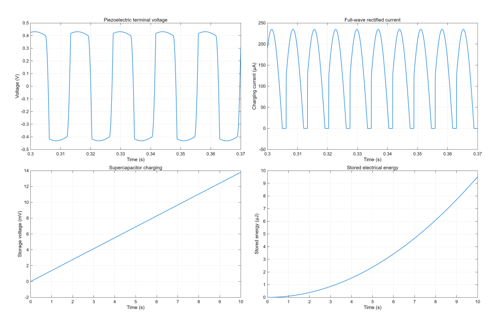

# Piezoelectric Rail Vibration Energy Harvesting

An engineering project exploring how railway vibration can power low-energy devices through piezoelectric conversion and electrical storage.

**Rail vibration → piezoelectric conversion → rectification → storage**

[Full design report (PDF, Chinese)](assets/%E8%AF%B4%E6%98%8E%E4%B9%A6.pdf)

## My contributions

| Area | What I did |
| --- | --- |
| System design | Contributed to a cantilever harvester design linking mechanical excitation, piezoelectric conversion and storage. |
| MATLAB / Simulink | Modelled vehicle loading and sleeper dynamics to estimate mechanical excitation. |
| COMSOL | Investigated the effects of structural dimensions and boundary conditions on stress and voltage output. |
| Simscape | Modelled bridge rectification and capacitor storage to examine the electrical charging path. |

## Selected work

<table>
  <tr>
    <th width="50%">Device concept</th>
    <th width="50%">Piezoelectric arrangement</th>
  </tr>
  <tr>
    <td align="center" valign="middle"></td>
    <td align="center" valign="middle"></td>
  </tr>
  <tr>
    <td align="center">Internal assembly</td>
    <td align="center">Energy conversion and proposed tuning</td>
  </tr>
</table>

<table>
  <tr>
    <th width="50%">Vehicle dynamics</th>
    <th width="50%">Sleeper excitation</th>
  </tr>
  <tr>
    <td align="center" valign="middle"></td>
    <td align="center" valign="middle"></td>
  </tr>
  <tr>
    <td align="center">Vehicle loading model</td>
    <td align="center">Mechanical input to the harvester</td>
  </tr>
</table>

<table>
  <tr>
    <th width="50%">Parameter responses</th>
    <th width="50%">Structural response</th>
  </tr>
  <tr>
    <td align="center" valign="middle"></td>
    <td align="center" valign="middle"></td>
  </tr>
  <tr>
    <td align="center">Load, acceleration and frequency plots</td>
    <td align="center">Response contour from the team report</td>
  </tr>
</table>

<table>
  <tr>
    <th width="50%">Electrical circuit</th>
    <th width="50%">Charging response</th>
  </tr>
  <tr>
    <td align="center" valign="middle"></td>
    <td align="center" valign="middle"></td>
  </tr>
  <tr>
    <td align="center">Rectification and capacitor storage</td>
    <td align="center">Voltage, current and stored energy</td>
  </tr>
</table>

*The supplementary Simscape model uses illustrative parameters to demonstrate capacitor charging. It does not validate field performance, closed-loop tuning or battery charging. Click the model and result images for full resolution.*

Team project at **Southwest Jiaotong University**. Full design details, references and team credits are in the [Chinese report](assets/%E8%AF%B4%E6%98%8E%E4%B9%A6.pdf).
